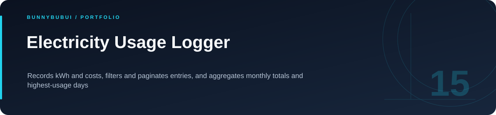
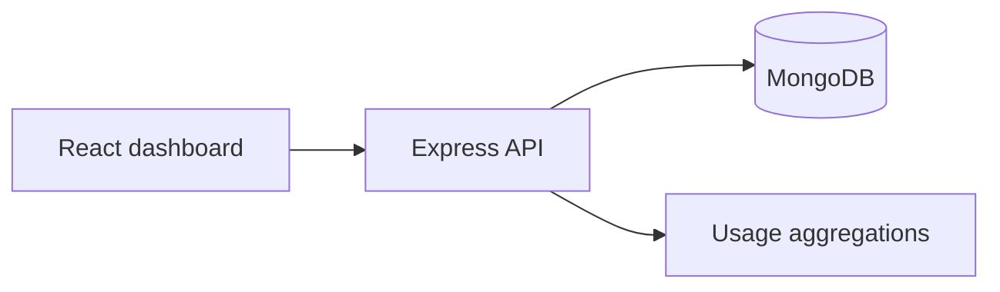

<p align="center">
  
</p>

<h1 align="center">Electricity Usage Logger</h1>

<p align="center">Records kWh and costs, filters and paginates entries, and aggregates monthly totals and highest-usage days</p>

<p align="center">
      
</p>

<p align="center"><a href="#overview">ภาพรวม</a> · <a href="#features">ความสามารถ</a> · <a href="#start">เริ่มใช้งาน</a> · <a href="#structure">โครงสร้าง</a> · <a href="#validation">ตรวจสอบงาน</a></p>

<a id="overview"></a>

## ภาพรวม

เว็บบันทึกการใช้ไฟฟ้าและค่าใช้จ่าย แยก React frontend กับ Express API และใช้ MongoDB สำหรับเก็บข้อมูลและสรุปสถิติ

<a id="features"></a>

## ความสามารถที่มีใน source

| ส่วนงาน | รายละเอียด | อ้างอิง |
|---|---|---|
| **บันทึกหน่วยไฟ** | บันทึก kWh และคำนวณค่าใช้จ่าย | [ดู source](server/src/routes/entries.js) |
| **ค้นรายการ** | กรองวันที่และแบ่งหน้า | [ดู source](server/src/routes/entries.js) |
| **สถิติ** | เปรียบเทียบรายเดือนและจัดอันดับวันใช้ไฟสูง | [ดู source](server/src/routes/stats.js) |
| **Dashboard** | แบบฟอร์ม ตาราง และสรุปข้อมูล | [ดู source](client/src/components/) |

### เส้นทางการทำงาน



<a id="start"></a>

## เริ่มต้นใช้งาน

**สิ่งที่ต้องมี:** Node.js 22+ และ MongoDB; กำหนด MONGODB_URI ให้ชี้ฐานข้อมูลในเครื่อง

```sh
cd server
cp .env.example .env
npm install
npm start

# Terminal 2, from repository root
cd client
cp .env.example .env
npm install
npm run dev
```

ตั้ง `VITE_API_BASE=http://localhost:8080/api` ให้ตรงกับพอร์ต backend; frontend พัฒนาใช้พอร์ต 5173

<a id="configuration"></a>

## การตั้งค่า

ตัวอย่างค่าตั้งค่าอยู่ในไฟล์ต่อไปนี้ คัดลอกไปยังชื่อไฟล์ local ที่โปรเจกต์อ่านและกำหนดค่าของเครื่องที่ใช้

| ไฟล์ตัวอย่าง | ตัวแปรสำคัญ |
|---|---|
| [client/.env.example](client/.env.example) | `VITE_API_BASE` |
| [server/.env.example](server/.env.example) | `PORT`, `MONGODB_URI`, `UNIT_PRICE_THB`, `CORS_ORIGIN` |

<a id="api"></a>

## API โดยย่อ

| Method | เส้นทาง | หน้าที่ |
|---|---|---|
| GET | `/api/health` | ตรวจ API |
| POST / GET | `/api/entries` | บันทึกและอ่านข้อมูล |
| GET | `/api/stats/summary` | สรุปรายเดือน |
| GET | `/api/stats/top-days` | วันที่ใช้ไฟสูง |

<a id="structure"></a>

## โครงสร้างที่ควรเริ่มอ่าน

| ตำแหน่ง | หน้าที่ |
|---|---|
| [server/](server) | backend และการตั้งค่า |
| [client/](client) | React frontend |

<a id="validation"></a>

## คำสั่งและผลตรวจ

| โฟลเดอร์ที่รัน | คำสั่งที่มีใน package |
|---|---|
| `client` | `npm run build` |

ดู [ผลตรวจที่บันทึกไว้](docs/VALIDATION.md) สำหรับขอบเขตการทดสอบรอบเตรียมพอร์ต

<a id="reading"></a>

## อ่านต่อ

- [บันทึกการเตรียม source](docs/CLEANUP.md)


---

<p align="center"><a href="https://github.com/BunnyBubui">BunnyBubui</a> · <a href="https://github.com/BunnyBubui/test">Software Portfolio</a></p>
